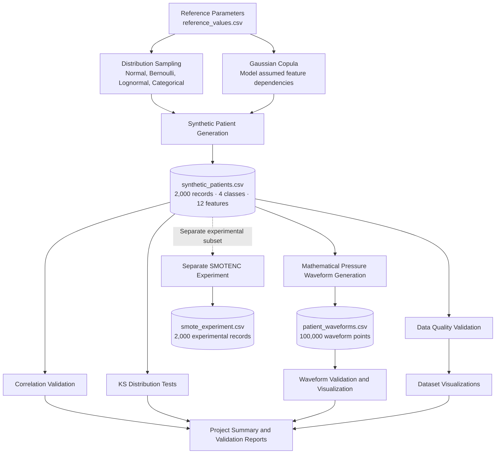

# CardioSynth — System Architecture

## Important Notes

- Gaussian Copula models **assumed statistical dependencies**; these are not clinically validated relationships.
- The pressure waveforms are mathematical demonstrations, not measured patient signals.
- SMOTENC runs separately and does not modify the original patient dataset.
- The architecture represents the implemented project workflow, not a clinical diagnostic system.
